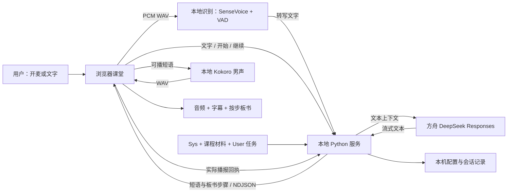

# 三茅老师 · AI 一对一课堂 Demo｜MVP 产品需求方案

版本：v0.1；更新：2026-11-22。本文依据本项目当前代码与本次产品讨论编写，供演示、内容调试和后续开发使用。实现状态与验证记录分开说明。

## 1. 产品目标

搭建一个可在本机运行的 AI 一对一课堂：用户选择一门课，以讲解模式学习，或以面试模式练习同一主题的表达、判断和追问。交互以语音为主，主体为随讲解逐步生成的板书。首个完整内容样本是用户提供的 Rubric 跑分流程。

MVP 重点验证内容、课堂推进、语音和板书能否共同形成连续的一对一体验：老师知道本轮应讲什么、何时等待、如何回应补充，并把正在说的关键内容展示出来。

优先级：有效回应的等待时间 → 内容准确 → 针对实际回答推进 → 语音与板书同步。长期评估与下一步规划保留为后续能力。

## 2. 用户、问题与验证假设

第一类用户是希望理解 AI 教学系统、准备相关主题面试的学习者。第二类用户是编辑 Sys、User 和专业材料、检查课堂效果的产品与内容设计人员。默认“吴同学”只是可编辑的演示称呼，不代表已知年龄、年级或专业经历。

本次讨论提供的问题依据：

1. 用户说完不知道有没有识别、提交，模型等待期间缺少明确反馈。
2. 一次性输出全部课程和板书，容易失去当前重点，也不利于按实际理解推进。
3. 通用项目经历面试不符合需求；真正需要的是围绕 Rubric 可能怎么问、如何追问。
4. 面试与讲解的入口不明显，课程主题缺少目录承载。
5. 首声慢、重复回应已答问题、未知板书操作阻断课堂，会破坏连续交流。

验证假设：同一份专业材料结合不同角色规则、分轮任务和实际回答，可以支持讲解与主题面试；短语生成、合成、播放交叠，可以降低感知等待。当前尚无规模化用户研究、学习效果统计或商业转化数据，不据此宣称假设已经成立。

## 3. MVP 范围与信息结构

### 3.1 课程目录

左侧使用可收起的轻量文字目录，不设置贯穿屏幕的白色侧栏。整体架构排在最前面，当前选中 Rubric。

| 顺序 | 课程 | 当前状态 |
|---|---|---|
| 1 | 整体架构 | 目录占位，课程内容待准备；本文可作为后续备课依据 |
| 2 | Rubric | 已接入讲解内容与专题面试任务 |
| 3 | 板书 | 目录占位，课程内容待准备 |
| 4 | 学习系统 | 目录占位，课程内容待准备 |
| 5 | 实时教学系统 | 目录占位，课程内容待准备 |
| 6 | 教具 | 目录占位，课程内容待准备 |
| 7 | 自动化内容生产 | 目录占位，课程内容待准备 |

目录中的名称是课程主题，不等于已经建设了对应的独立服务。其他课程暂不启动；当前可运行内容集中在 Rubric。

### 3.2 两种模式

顶部常驻“讲解模式 / 面试模式”切换，选中态与板书角标一致。课程名持续显示，板书主标题随当前重点变化。切换模式结束当前会话、停止播报和收音，保留课程选择，在新会话中使用对应任务；不会把讲解阶段的表现自动视为面试能力证据。

**讲解模式**：简短问候 → 课程标题与预告 → 分节讲解 → 围绕刚讲内容检查判断与理由 → 回应、补讲或继续。支持用户插问，重要关系用结构图展示。

**面试模式**：说明当前主题 → 问一道实质问题 → 等待回答 → 根据实际回答追一个缺口，或进入下一主问题。默认不先教答案。用户明确提出“可能怎么问、会怎么追问、怎么答”时，转为题目分析与面试准备讨论；用户明确恢复模拟后再继续提问。

### 3.3 本期不包含

面试评分、正式评估报告、下一步学习任务、跨课学情推断、账号与多租户服务、线上多人课堂、生产级并发与监控，以及完整自动化内容生产平台。本地保留历史会话供调试，不等于已实现长期学习记忆。

## 4. 关键用户流程与需求

### P0-1 明确课程和模式

用户打开页面时看见当前课程 Rubric、当前模式和开始按钮。刷新不自动上课。目录可收起，收起后板书获得更多空间；小屏默认收起。模式切换始终可见，不藏在内容编辑器里。

验收：整体架构位于目录首位；Rubric 被选中；切到面试后标题、角标、任务与“开始面试”一致；切回讲解后仍为 Rubric。未备课的课程明确标为待准备。

### P0-2 开麦或文字输入，老师均语音回应

只提供开麦和文字两种输入入口。开麦时持续采集、自动判断发言起止并提交；文字直接提交，跳过识别环节。学生转写、接收状态与老师字幕都可见。

验收：学生能够区分“正在收音、正在识别、已收到、等待模型”；文字输入也能听到男声，并同步看到板书。没有有效语音时不提交虚构文字；麦克风权限或识别失败可见且能重试。

### P0-3 有实质内容的快速首声

模型一边生成文本，系统一边提取可读短语、合成语音并播放，后续内容继续生成。首句是解释、回答或面试问题，不用“收到、稍等”伪装低延迟。

验收：具备条件时，第一段实际音频先于完整模型回复开始播放；界面同时显示 TTFT 和首声时间。音色为中文男声 `zm_011`，语速默认 1.20 倍，可在 0.75—2.00 倍间调整。

### P0-4 连续交流与句尾调整

老师思考或等待首声时，新输入进入补充队列，不取消当前请求、不重置该轮 TTFT。播放到完整句子边界时检查补充，结合已说内容调整后续。对“嗯、继续”等确认和实质问题分别处理。显式暂停、新会话、切换模式才主动结束对应运行流程。

验收：连续输入不会使老师一直从头思考；未播出的后半句不当作用户已经听到；已回答的问题不反复回答。暂停后语音和嘴型停止，继续后依据实际进度衔接。

### P0-5 板书是主画面

板书保持完整 16:9，占据主要空间，聊天记录默认隐藏。随实际口播逐条出现文字、节点、连线和局部标注。新内容追加在末尾，默认滚到底部；回讲旧内容才定位到对应位置，继续新增后回到底部。手动翻看暂停自动跟随，可点击“跟随讲解”恢复。

当前页保留正在讨论的关键内容，允许清除无关过程并保留必要结论。下一节 User 注入后，在首段播报时进入新页；旧页可回看，右上角显示当前页和已讲页数。取消翻页、镜头推进和文字飘入效果，等待时只显示真实加载反馈。

验收：未讲到的板书不提前出现；长内容固定字号并可滚动；当前问题在板书上清晰可见。未知或无效操作跳过并记录，不能仅因一条板书操作使可用语音全部丢弃。

### P0-6 Rubric 专题讲解与面试

讲解以原图事实为依据，使用“同一 case 像同一道题与情境、两版回复像答卷、Rubric 像评分标准、裁判像阅卷老师”的类比。随后明确本图采用逐项达标、不达标、不适用与 Must-have 否决制，不能把它讲成简单加总分。

面试围绕五个主题：Rubric 与裁判分工、公平对比、可判定标准与 Must-have、汇总口径、裁判可信度与结论边界。例如先问“为什么引入 Rubric，而不是让裁判直接选优”；只回答“更客观”时，追问如何把“讲得好”改成可判定标准。

验收：不以介绍简历或真实项目开场；每轮只问一个主问题或追问；追问引用真实回答中的缺口，不假设用户犯错。主问题与追问上板书，默认模拟不提前显示参考答案。题目分析时说明哪些是示例追问，不假装知道实际公司的题库。

### P0-7 内容可编辑，过程可检查

内容编辑器保留 Sys、本次 User、专业材料和用户资料；修改保存到本机，对新会话生效。运行检查展示实际 Sys、User、模型输出、事件和历史。底部显示收音/输入、转写、提交、模型、语音、板书和播放状态。

验收：能判断卡在识别、模型、合成还是播放，不仅显示“老师思考中”。教师形象的张嘴由实际播放驱动，倾听由实际收音驱动；三根彩色头发表示正在生成，鼓励时三颗爱心随话术出现。

## 5. Sys、User 与运行系统怎样分工

本 Demo 将 Sys 和 User 实现为同一次模型调用中的两层内容，不是两个单独部署、互相聊天的 Agent。

| 层 | 承担内容 | 当前实现 |
|---|---|---|
| Sys | 相对稳定的身份、讲解或面试行为、边界、输出格式 | `prompts/lecturer.md`、`prompts/interviewer.md`；流式链路附加 `stream_instructions.md` |
| User | 当前任务、材料、用户资料、已发生对话、当前环节、尚未回应的输入、本轮行动 | `server.py::compile_input`，Rubric 讲解再由 `lesson_sections.py` 限定当前 section |
| 模型输出 | 本轮说什么、写什么、是否等待、是否结束 | `steps[{speech, ops}]`、`phase`、`await_user`、`done`、`adaptation` |
| 运行系统 | 发请求、排队、合成、播放、执行板书、保存实际播报状态与推进条件 | Python 服务与浏览器控制器共同执行 |

直接让模型扮演面试官可以生成问题，但无法仅靠角色提示可靠地承担麦克风采集、排队、播放、板书执行和进度提交。把所有内容放进 Sys 也能发出请求，但会混淆稳定规则和当前任务，并持续携带无关资料。因此把角色规则、当轮内容与确定性的执行分别组织。

### Rubric 讲解如何分轮

当前默认方舟讲解路径使用八个 section：开场与全貌 → 固定 case → 两路生成 → 裁判与检查项 → 整条 PASS/FAIL → 两种通过率 → 原图案例对照 → 收束与边界。

每个 section 可以有多轮讲解、插问和理解检查；`steps` 只是单轮回复中的口播与板书步骤。每轮主要传当前 section 的资料和目标、简短总纲、当前环节近期历史、上一节已播内容摘要及未处理输入；明确跨节问题可补少量相关资料。

只有实际播报完成、目标覆盖报告满足要求、必要图示已呈现且没有等待作答时，后续 continue 才能推进下一 section。当前覆盖报告来自模型，不能替代独立的掌握度评估。面试路径目前使用主题任务、题目提纲与实际历史逐轮推进，尚未接入同一套 section 调度器，也没有独立的确定性题库状态机。

## 6. 系统架构与运行链路



实际部署为一个本地 Python HTTP 服务加静态浏览器页面。识别、TTS、上下文组装是同一项目中的模块，不要求各起一个微服务。默认只有语言模型推理使用远程方舟 API；另有可选本地 Qwen 与 Codex 对照路径。

一次开麦回应的顺序：

1. 浏览器 AudioWorklet 采集音频，音量与停顿判断发言起止。当前句末静默阈值为约 650 ms。
2. 音频作为 PCM WAV 发往本机，Silero VAD 过滤无语音片段，SenseVoice 转文字。原始录音不落盘。
3. 输入排队，冻结本轮对应的角色、任务、历史与当前状态，拼出模型 User。
4. 方舟返回文本流，后端增量解析 `steps`，通过 HTTP NDJSON 向页面发送文本、可播短语与板书操作。不是将音频直接交给语言模型。
5. 浏览器拿到完整短语就请求本地 TTS；下一段合成与当前段播放交叠。当前实现是“文本流式 + 短语音频分段播放”，不是逐个 token 直接产生声波的原生语音到语音流。
6. 音频开始播放时更新字幕、嘴型及对应板书。若对应操作稍后才到达，在该步已开始播放后补执行，不提前展示未来步骤。
7. 完整句子结束时检查补充输入；本轮实际播完后提交 delivery 回执。按 `await_user` 决定等待或继续，分节调度只依据实际完成条件推进。

## 7. 依赖的模型与组件

| 能力 | 当前默认选择 | 部署位置与作用 |
|---|---|---|
| 语音识别 | SenseVoice Small int8，中文优先 | 本地 sherpa-onnx，接收音频、输出转写；Whisper base 为备用 |
| 无语音过滤 | Silero VAD，由 faster-whisper 的 VAD 接口使用 | 本地过滤噪声/静默，区别于浏览器按音量触发 |
| 讲解与面试生成 | `deepseek-v4-1-flash-economy-261017` | 方舟 Responses API；流式、thinking disabled、store false；此链路发送文本，不发送原始音频 |
| 语音播报 | Kokoro v1.1-zh，中文男声 `zm_011` | 本地 ONNX CPU 推理，中文 G2P 与英文片段发音；不自动换女声 |
| 本地语言模型对照 | Qwen3-4B-Instruct-2507，MLX 4bit | Apple Silicon 本地运行，当前保留旧板书协议，不是默认路径 |
| Codex 对照 | 本机已安装、已登录的 Codex CLI | 可选对照执行；并非调用桌面应用内部的隐藏 API |

语气标注通过 `[重读]`、`[慢]`、`[快]`、`[停顿:300]` 做增益、语速和停顿控制，当前不是原生情绪合成。浏览器语速默认 1.20 倍且保留音高；英文按原文朗读，不把中文翻译冒充英文发音。

核心运行依赖见 [requirements.txt](../requirements.txt) 与 [requirements-local.in](../requirements-local.in)：Python、HTTPx、faster-whisper、sherpa-onnx、kokoro-onnx、misaki 中文发音组件；本地语言模型另需 MLX。前端使用原生 HTML、CSS、JavaScript 模块、Web Audio 和 SVG，没有前端构建服务依赖。浏览器回归测试使用 Node 与专用 Chrome。

原 Rubric 流程图中的教学模型和裁判型号只是教学材料中的实验配置，不是本 Demo 正在执行 Rubric 跑分或使用那个裁判评估用户。

## 8. 本地怎样搭建和调试

已验证的环境为 macOS Apple Silicon、Python 3.12 与专用 Chrome。其他系统的兼容性未做同等验证；默认远程模型需要网络及方舟凭据。

### 8.1 环境与模型准备

在项目根目录执行；已有虚拟环境与已验证模型时不必重复安装或下载：

```sh
uv venv --python 3.12 .venv
uv pip install --python .venv/bin/python -r requirements.txt
uv pip install --python .venv/bin/python -r requirements-local.in
.venv/bin/python prepare_voice.py
.venv/bin/python prepare_local_models.py
.venv/bin/python prepare_sensevoice.py
.venv/bin/python verify_voice_models.py
```

目前 `prepare_local_models.py` 同时下载 Kokoro 和可选 Qwen，尚未拆成最小下载入口。下载成功与实际推理成功分开标记：`.downloaded` 表示资源准备，`.ready` 表示相应验证通过。Qwen 的推理验证与默认方舟课堂运行分开处理。

将方舟密钥配置为 `ARK_API_KEY` 环境变量，或保存在 `data/credentials/ark.key`，权限设为 600。密钥不放进代码、浏览器、会话导出或需求文档。`data/` 与 `models/` 都不进入 Git，因此新电脑拉取仓库后需要自行准备。

### 8.2 启动与演示

```sh
./start.command
```

浏览器打开 `http://127.0.0.1:8765`。启动时预热语音模型与远程连接；准备好后再允许开始。选择 Rubric、讲解或面试，确认姓名和输入方式，点击开始。默认男声未就绪时显示错误；不会用其他声音掩盖准备失败。

### 8.3 内容和代码入口

| 需要改什么 | 入口 |
|---|---|
| 讲师 / 面试官稳定规则 | `prompts/lecturer.md`、`prompts/interviewer.md` |
| Rubric 原图事实 | `content/rubric/material.md`、`source.svg`、`source-text.md` |
| 讲解设计与当前分节 | `content/rubric/user-task.md`、`sections.json` |
| 面试任务与条件追问 | `content/rubric/interview-task.md`、`interview-guide.md` |
| 上下文、会话、HTTP API | `server.py`、`lesson_sections.py` |
| 远程流式接入 | `ark_model.py`、`stream_instructions.md` |
| 识别、播报与切句 | `speech_recognition.py`、`local_models.py`、`speech_markup.py` |
| 前端调度与采集 | `static/app.mjs`、`voice.mjs`、`capture-worklet.js` |
| 课程目录、板书与可视反馈 | `static/course-navigation.mjs`、`live-board.mjs`、`teacher-feedback.mjs`、`pipeline.mjs` |
| 本机保存和调试证据 | `data/config.json`、`data/sessions/`、`data/audio/` 与验证 JSON、截图 |

会话开始时保存配置快照。修改页面配置或内容文件后，新会话使用新内容；当前会话不随文件变化而悄悄替换上下文。

## 9. 成功指标与验收方法

首要目标是热启动后，用户说完到第一段有意义音频播放尽量控制在 3 秒内。这是优化目标，当前没有达到稳定三秒的统计证据，也不等于整个回答在三秒生成完毕。

| 指标 | 定义 | 验证方式与现状 |
|---|---|---|
| 首声 | 语音末尾实际停声 / 文字提交，到浏览器开始播放首段音频 | 包含分句等待、识别、队列、模型、合成与传输；分别记录冷启动和热启动 |
| TTFT | 后端发起模型请求到收到首个文本增量 | 包含请求与服务端等待，不能当作纯模型计算时间，也不能替代首声 |
| 首段话术 | 模型请求开始到积累出可播短语 | 用于区分首个 token 与可合成文本 |
| 板书同步 | 对应内容实际口播开始与板书执行的关系 | 检查未来内容不提前显示、无效操作不阻断有效语音 |
| 语音有效识别 | 转写是否保留用户真实关键意图与术语 | 需真人、噪声、中英术语样本；合成音频通过不等于真人准确率已达标 |
| 针对性追问 | 是否针对真实回答中的依据、遗漏或矛盾 | 人工检查同题不同回答；不能只用“模型有回复”作为通过条件 |

已记录的一次合成语音全链路样本为 TTFT 1616 ms、首声 3775 ms，来自此前本机验证，非平均值或分位数。见 [验证记录](验证记录.md)。后续应积累代表性开麦与文字样本，分别统计 P50/P95、错误率和中断情况；当前不编造这些统计。

基础检查：

```sh
.venv/bin/python -m unittest discover -s tests -v
node --test tests/voice.test.mjs
```

真实模型检查可运行 `.venv/bin/python verify_interview.py`；专用测试 Chrome 已启动且 CDP 端口为 9227 时，可运行 `node tests/browser_smoke.mjs --staged` 与 `--interview`。前者使用模拟响应验证交互，后者实际调用模型并播放合成语音。详细证据保存在本机 `data/`，不包含在公开文档中，也不将测试历史当成真人作答。

## 10. 约束、风险与后续决策

1. **延迟**：远程模型等待、句末静默、本地 TTS 和补充排队都会影响首声。优先测实际播放时间，再决定压缩上下文、切句策略或替换链路，不能只优化 TTFT 数字。
2. **识别**：当前音量触发与中文优先识别对噪声、吞字和中英混读仍可能出错。保留可见转写与文字入口；真实语音样本覆盖待补齐。
3. **内容与进度**：模型可能漏讲、重复或误判已答充分；分节和实际播放回执提供约束，但覆盖报告不能证明掌握。后续需要独立定义学习评估的证据体系。
4. **面试组织**：当前题目提纲与历史驱动追问，尚无硬性的题目完成状态机。若继续扩充题库，应明确题目标识、已问内容、追问次数、跳过与恢复规则。
5. **数据**：录音本地识别；默认方舟接收任务、材料、画像和转写文本。`store=false` 是当前 API 配置，不等于对供应商全部数据处理行为作额外承诺。会话和合成音频缓存留在本机，清理策略待补充。
6. **部署**：当前是本机 Demo，不是生产级实时课堂服务。并发、鉴权、部署运维、资源隔离和正式 SLA 未纳入本期验收。

后续工作按验证需要推进：先完成 Rubric 真人连续对话与延迟采样，再准备整体架构等其他课程；随后明确跨课评估、下一步规划和生产服务化方案。负责人、排期和上线门槛尚未指定，不在本文中虚构。
